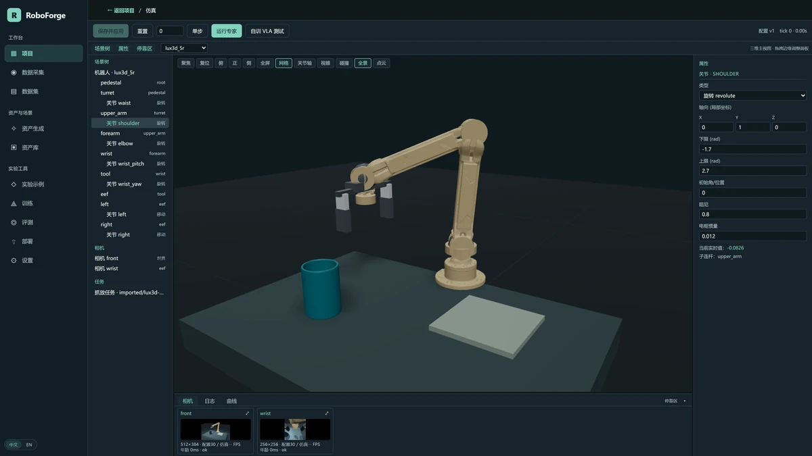

# RoboForge

**English** · [简体中文](README.zh-CN.md)

[](LICENSE)
[](#quick-start)
[](requirements.txt)
[](docs/MODEL_INTEGRATION.zh-CN.md)
[](#collection-and-replay)
[](docs/GENERATION_WORKFLOW.zh-CN.md)

RoboForge is a browser workbench for robot simulation, asset validation, and demonstration collection. Bring Aholo-generated or local 3D assets into MuJoCo, check scale, contact, grasping and camera views, then record trajectories with images, robot state, actions and task instructions. Export datasets for external training or connect an existing policy for closed-loop testing in the same scene.



[Quick start](#quick-start) · [Assets and scenes](#assets-and-scenes) · [Collection and replay](#collection-and-replay) · [Connect an existing model](#connect-an-existing-model) · [Documentation](#documentation)

## Quick start

The example uses Windows PowerShell, Python 3.13, Node.js 20 or later, and npm. Camera rendering requires a working OpenGL context. Start the backend from the repository root.

```powershell
py -3.13 -m venv .venv
.\.venv\Scripts\python.exe -m pip install -r requirements.txt
.\.venv\Scripts\python.exe -m uvicorn vlab.api:app --host 127.0.0.1 --port 8767
```

In another terminal, start the frontend from the repository root.

```powershell
cd frontend
npm ci
npm run dev -- --host 127.0.0.1 --port 5173
```

1. Open the [project workbench](http://127.0.0.1:5173/projects) and click **Open simulation** (打开仿真) on the default project. The backend creates a default tabletop pick-and-place project on first startup.
2. Select a joint or camera in the scene tree and inspect its properties. Apply edits with **保存并应用** (Save and apply) to save a new project configuration version.
3. Click **重置** (Reset), then **运行专家** (Run expert). Observe contact, lift and placement. The camera panel shows the front and wrist views. The 3D viewport has its own inspection camera, while recording uses the project's configured sensors.

This workflow uses bundled assets and a servo expert and needs no Aholo credentials or model weights. Vite proxies `/api` and `/assets` to the backend. To use another backend address, set `VLAB_API_ORIGIN` before starting Vite. See the [FastAPI documentation](http://127.0.0.1:8767/docs) once the backend is running.

## Assets and scenes

1. **Generate or import.** Under **资产生成** (Asset generation), choose a task object, static prop, robot appearance, scene mesh or panorama/3DGS background. Use **自由生成 3D 外观** to generate a single visual mesh from a description. Preview the request before confirming it. Import GLB or PLY scenes in the asset library, or use the [single-asset importer](asset_pipeline/README.md) for a cup-shaped GLB or ZIP.
2. **Configure physics.** Check units, size, and support surfaces, then set collision geometry, mass and friction for the intended physical role. For a robot appearance, attach mesh parts to configured links. The robot configuration defines joints, limits, actuators and the gripper. Download the asset's binding guide after registration for its reference and setup steps.
3. **Validate and apply.** Select the task object, work surface and target project in the scene recipe. Run **创建配方并校验** (Create and validate recipe). Apply it as a new project version after the MuJoCo build and short stability check pass. Run the scene to inspect grasp contact, tray support and camera coverage.

**Online services.** In **Settings** on the backend host, configure the Aholo API key, or set `AHOLO_API_KEY` in the backend process. See the [asset import guide](asset_pipeline/README.md) for Lux3D and [requirements-world.txt](requirements-world.txt) for World dependencies. Conversation-assisted specification requires an auxiliary LLM. Forms, JSON edits, and local import are available independently. See [.env.example](.env.example) for environment variables.

**Backgrounds and cameras.** Aholo World 3DGS can provide a fixed front view through the Hybrid renderer. Separate physics geometry provides the support surfaces and contact. Use MuJoCo rendering to record front and wrist views together. Keep asset provenance, scene version and physics parameters with the collection.

## Collection and replay

| Goal | Entry point |
| --- | --- |
| Record one demonstration | In **数据采集** (Data collection), choose an object, one trial, and a starting seed. Open the dataset when capture finishes. |
| Collect from a specific project | In **数据集** (Datasets), select a project, enter a new collection ID and submit **采集（伺服专家）** (Collect with servo expert). The job uses a snapshot of the project configuration at submission. |
| Inspect camera frames | Open an NPZ dataset and select an episode under **相机帧预览** (Camera frame preview) to see the beginning, middle and end. |
| Play a trajectory | For Task Studio captures, select a demonstration under **数据与回放** (Data and replay) to play or scrub it. Use the script below for MP4 export from raw dual-camera tabletop NPZ data. |
| Export to LeRobot | In Datasets, enter the source collection ID and a new target dataset ID, then select **转换 LeRobot** (Convert to LeRobot), or use the CLI below. |

A raw collection contains `manifest.json` and `episodes/*.npz`. Tabletop demonstrations include images, joint and end-effector state, gripper state, actions, task instructions, and timing. Inspect a short recording before varying assets, cameras, or seeds across a batch.

Collect one episode and export a dual-camera replay from the repository root. MP4 export needs `ffmpeg` on PATH.

```powershell
$capture = "datasets/collections/readme-" + (Get-Date -Format 'yyyyMMdd-HHmmss')
.\.venv\Scripts\python.exe scripts/collect_expert.py --episodes 1 --out $capture
.\.venv\Scripts\python.exe scripts/replay_episode.py --staging $capture --episode 0 --out "$capture/replay"
```

Use a separate LeRobot environment for conversion. The recorded tabletop conversion setup used Python 3.11 and LeRobot 0.4.4, with PyTorch and Parquet dependencies. Replace the example paths with an existing capture and an unused output directory. The converter reloads the result with LeRobot and saves the simulation manifest and per-frame timing.

```bash
python scripts/lerobot_writer.py --staging datasets/collections/your-capture --out datasets/lerobot/your-export
```

The web conversion job calls the converter through WSL. To use it, set `VLAB_WSL_DISTRO`, `VLAB_LINUX_LAB`, `VLAB_LINUX_DEPS`, and `VLAB_LINUX_PYTHON` to match your installation.

## Connect an existing model

Set the input and output contract against a particular project version. An asset guide covers the use of one asset. The **project binding guide** lists the robot, joints, sensors, and controllers for the saved project. Download it after applying a recipe or request a specific version through the API.

| Step | What to check |
| --- | --- |
| Select project and robot | Read `GET /api/v1/config?project=default` and `GET /api/v1/capabilities?project=default`. Use the chosen robot's `controller_ids` and `sensor_ids`. |
| Bind observations | Read named values from `state.joint_pos` and `state.joint_vel` in training order. Map image inputs to sensor IDs such as `front` and `wrist`. Decode JPEG, apply the model's preprocessing, and check frame time and availability. |
| Map actions | Use the controller's `action_names`, `units`, `action_range` and `frequency_hz`. Match the coordinate frame, absolute versus delta semantics, and gripper convention. |
| Check and step | Check the contract with `POST /api/v1/compat`. Open a session, confirm the configuration version, acquire control, read an `observation`, then send a hold action with the current `token`, `epoch` and `tick`. Inspect the next observation. |

Request the guide with `GET /api/v1/projects/{project_id}/binding-guide?version={version}`. The [model integration and asset binding guide](docs/MODEL_INTEGRATION.zh-CN.md) includes a minimal HTTP client. You can also use the WebSocket at `/api/v1/ws/{sid}` or the [VLabGymEnv](vlab/gym_env.py) Gymnasium interface.

The default tabletop example uses a five-revolute-joint arm with a two-finger gripper. Its `cartesian` controller accepts normalized `[dx, dy, dz, grip]`. The three-axis gantry has a separate [joint-position configuration](configs/second_robot.json). For a different robot, check its controller, camera mounts and task criteria. The built-in fixed-pose pick-and-place expert needs a compatible kinematic chain and gripper. See the [platform scope](docs/PLATFORM_SCOPE.zh-CN.md).

## Experiments and extensions

- **Two-object demo.** On Windows, run [start_demo.ps1](start_demo.ps1) after installing the backend and frontend dependencies to prepare `hackathon_demo`. The toolbar's **自训 VLA 测试** (Custom VLA test) needs the inference environment and `config.json`, `so100_stats.json`, and `model.safetensors` under `datasets/models/so100_smolvla_omni/`. Use MuJoCo front and wrist cameras and ask the policy to place an object present in the scene into the tray.
- **Experiment examples.** The workbench also links to mobile transport, conveyor sorting, base driving, full-scene generation, and Task Studio. These have their own scene, data or policy configurations. See [transport](frontend/MOBILE_TRANSPORT.md), [sorting](frontend/DUCK_SORTING.md), [base driving](frontend/MOBILE_DEMO.md), [scene generation](frontend/SCENARIO_WORKBENCH.md), and [Task Studio](frontend/STUDIO.md).
- **Configuration and simulation exports.** The robot editor exports the saved URDF. The [MJCF exporter](scripts/export_mjcf.py) writes MuJoCo XML for the default scene and references mesh files. The repository also includes examples for [BC training](scripts/train_bc.py), [closed-loop evaluation](scripts/eval_policy.py), and [policy bundle export](scripts/export_deploy.py).

## Documentation

| Guide | Covers |
| --- | --- |
| [Platform scope](docs/PLATFORM_SCOPE.zh-CN.md) | Tabletop robots, sensors, controllers, and collection requirements |
| [Asset generation and scene recipes](docs/GENERATION_WORKFLOW.zh-CN.md) | Generation sessions, import, validation, application, and provenance |
| [Scene editor](docs/SCENE_EDITOR.zh-CN.md) · [Rendering and timing](docs/RENDERING_PIPELINE.zh-CN.md) | Collision proxies, calibration, camera mounts, and timestamps |
| [Model integration and asset binding](docs/MODEL_INTEGRATION.zh-CN.md) | Joint and camera mappings, action contract, and minimal HTTP client |
| [Frontend architecture](docs/FRONTEND.md) | Page modules, data contracts, and localization |
| [Audit and validation](docs/AUDIT.md) | Dated findings, validation evidence, and limitations |

## Repository layout

```text
vlab/            MuJoCo engine, FastAPI, sessions, sensor scheduler, Gymnasium
frontend/        React / TypeScript workbench and 3D viewport
configs/         Default project and three-axis gantry configuration
assets/          Meshes, scenes, and provenance manifests
asset_pipeline/  Asset generation, import, and robot appearance assembly
scripts/         Collection, replay, conversion, and baseline experiments
tests/           Physics, configuration, API, and rendering checks
docs/            Workflows, integration guides, and validation records
```

Runtime project versions, captures, and deployment outputs are stored mainly in `projects/`, `datasets/` and `deploy/` and can be generated locally. Run these checks from the repository root.

```powershell
.\.venv\Scripts\python.exe tests/test_engine.py
.\.venv\Scripts\python.exe tests/test_api.py
cd frontend
npm run build
```

## License

Licensed under the [Apache License, Version 2.0](LICENSE). Third-party software, model and asset attributions are listed in [NOTICE](NOTICE).
