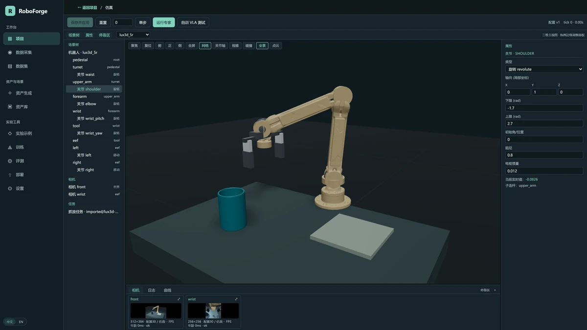

# RoboForge

[English](README.md) · **简体中文**

[](LICENSE)
[](#快速开始)
[](requirements.txt)
[](docs/MODEL_INTEGRATION.zh-CN.md)
[](#采集与回放)
[](docs/GENERATION_WORKFLOW.zh-CN.md)

RoboForge 是一个网页端机器人仿真、资产验证与数据采集工作台。你可以把 Aholo 生成或本地导入的 3D 资产装进 MuJoCo 场景，检查尺寸、碰撞、抓取和相机视角，再录制带图像、状态、动作与任务指令的示范轨迹。导出的数据可交给外部训练流程，已有策略也可接入同一场景做闭环测试。



[快速开始](#快速开始) · [资产与场景](#资产与场景) · [采集与回放](#采集与回放) · [接入已有模型](#接入已有模型) · [文档索引](#文档索引)

## 快速开始

以下以 Windows PowerShell 为例。准备 Python 3.13、Node.js 20 或更高版本及 npm。相机渲染需要可用的 OpenGL 上下文。在仓库根目录启动后端。

```powershell
py -3.13 -m venv .venv
.\.venv\Scripts\python.exe -m pip install -r requirements.txt
.\.venv\Scripts\python.exe -m uvicorn vlab.api:app --host 127.0.0.1 --port 8767
```

另开一个终端，从仓库根目录启动前端。

```powershell
cd frontend
npm ci
npm run dev -- --host 127.0.0.1 --port 5173
```

1. 打开[项目工作台](http://127.0.0.1:5173/projects)，在默认项目卡片点击「打开仿真」。后端在首次启动时创建默认桌面抓放项目。
2. 在左侧场景树选择关节或相机，在右侧检查属性。修改后点「保存并应用」，保存为项目配置新版本。
3. 点击「重置」，再点「运行专家」。观察目标物接触、抬升及放置。在底部相机面板查看前视与腕部画面。三维视口用于自由观察，采集使用项目配置中的传感器相机。

这条路径使用仓库自带的资产与伺服专家，无需 Aholo 凭据或模型权重。Vite 默认将 `/api` 和 `/assets` 代理至后端。如需修改后端地址，在启动前端前设置 `VLAB_API_ORIGIN`。启动后可打开 [FastAPI 接口文档](http://127.0.0.1:8767/docs)。

## 资产与场景

1. **生成或导入。** 在「资产生成」选择任务物体、静态道具、机械臂外观、场景网格或全景 / 3DGS 背景。仅生成外观时，选「自由生成 3D 外观」，只需描述目标。先预览生成请求，再明确确认提交。已有场景可从「资产库」导入 GLB 或 PLY，独立杯类 GLB / ZIP 可用[单体导入工具](asset_pipeline/README.md)。
2. **配置物理属性。** 核对单位、尺寸和支撑面，按物体用途配置碰撞、质量与摩擦。机械臂外观需分件绑定到已配置的连杆，关节轴、限位、执行器及夹爪由机器人配置定义。资产入库后可下载「绑定指南」，查看资产引用及下一步配置。
3. **校验并应用。** 在场景配方面板选择任务物体、工作台和目标项目，执行「创建配方并校验」。通过 MuJoCo 构建及短步稳定性检查后，将配方应用到新项目版本。进入仿真实跑，确认抓取接触、托盘支撑和相机覆盖范围。

**在线服务。** 从后端所在电脑打开「设置」，在「Aholo 3D 生成」配置 API Key，或给后端进程设置 `AHOLO_API_KEY`。Lux3D 依赖见[资产导入指南](asset_pipeline/README.md)，World 依赖列在 [requirements-world.txt](requirements-world.txt)。对话式整理规格需另配辅助 LLM。表单、JSON 和本地导入可独立使用。环境变量示例见 [.env.example](.env.example)。

**背景与相机。** Aholo World 的 3DGS 用于 Hybrid 固定前视背景，桌面与物体接触由独立的物理几何提供。采集前视与腕部双相机时，选择 MuJoCo 渲染。资产来源、场景版本和物理参数可用于追溯同一批数据的采集条件。

## 采集与回放

| 想做什么 | 从哪里开始 |
| --- | --- |
| 试录一条 | 在「数据采集」选择物体，将采集次数设为 1，填入起始种子后开始。采集结束后点「打开数据集」。 |
| 从指定项目采集 | 在「数据集」选择项目，填写新采集 ID，点「采集（伺服专家）」。作业使用提交时的项目配置快照。 |
| 检查相机帧 | 打开 NPZ 数据集，在「相机帧预览」切换示范，查看起始、中段和结束帧。 |
| 连续回放 | 「任务编排」生成的示范可在「数据与回放」播放和拖动进度。桌面双相机 NPZ 可用脚本导出 MP4。 |
| 导出 LeRobot | 在「数据集」填写原始采集 ID 和新的输出 ID，点击「转换 LeRobot」，也可以用下方命令行入口。 |

每批原始数据由 `manifest.json` 和 `episodes/*.npz` 组成。桌面抓放示范记录图像、关节状态、末端位姿、夹爪状态、动作、任务指令和时间信息。先用少量样本检查画面和动作对齐，再调整资产、相机或种子批量采集。

在仓库根目录采集并导出一个双相机回放。MP4 导出需要 `ffmpeg` 在 PATH 中。

```powershell
$capture = "datasets/collections/readme-" + (Get-Date -Format 'yyyyMMdd-HHmmss')
.\.venv\Scripts\python.exe scripts/collect_expert.py --episodes 1 --out $capture
.\.venv\Scripts\python.exe scripts/replay_episode.py --staging $capture --episode 0 --out "$capture/replay"
```

转换器使用独立的 LeRobot 环境。仓库记录的桌面转换环境为 Python 3.11 和 LeRobot 0.4.4，还需 PyTorch 及 Parquet 依赖。在该环境中从仓库根目录运行，将示例路径替换为实际采集目录和未占用的输出目录。转换会用 LeRobot 加载器回读检查，并保存仿真清单及逐帧时间信息。

```bash
python scripts/lerobot_writer.py --staging datasets/collections/your-capture --out datasets/lerobot/your-export
```

网页转换作业通过 WSL 调用转换脚本。使用网页按钮前，将 `VLAB_WSL_DISTRO`、`VLAB_LINUX_LAB`、`VLAB_LINUX_DEPS`、`VLAB_LINUX_PYTHON` 配置为本机实际环境。

## 接入已有模型

以项目版本为单位确定输入输出契约。资产指南说明单件资产如何使用，**项目绑定指南**列出实际运行的机器人、关节、传感器与控制器。应用配方后可下载项目指南，也可通过 API 获取指定版本。

| 步骤 | 做法 |
| --- | --- |
| 选项目和机器人 | 读取 `GET /api/v1/config?project=default` 与 `GET /api/v1/capabilities?project=default`。从选中机器人的 `controller_ids`、`sensor_ids` 取可用项。 |
| 绑定输入 | 按模型训练顺序从 `state.joint_pos`、`state.joint_vel` 按名称取值。将模型图像输入映射到传感器 ID，例如 `front`、`wrist`。解码 JPEG 后按训练约定处理图像，并检查帧时间和可用状态。 |
| 对齐输出 | 按控制器的 `action_names`、`units`、`action_range` 和 `frequency_hz` 转换模型动作。核对关节单位、坐标系、绝对值或增量及夹爪含义。 |
| 校验并试跑 | 用 `POST /api/v1/compat` 检查契约。创建会话并确认配置版本，获取控制权，读取 `observation`，携带 `token`、`epoch` 和 `tick` 发送一步保持动作，核对下一步观测。 |

项目指南接口为 `GET /api/v1/projects/{project_id}/binding-guide?version={version}`。完整 HTTP 客户端示例见[模型接入与资产绑定](docs/MODEL_INTEGRATION.zh-CN.md)，也可使用 `/api/v1/ws/{sid}` WebSocket 会话或 [VLabGymEnv](vlab/gym_env.py) 的 Gymnasium 接口。

默认桌面示例采用五旋转关节机械臂与双指夹爪。`cartesian` 控制器接受归一化的 `[dx, dy, dz, grip]`。三轴龙门有独立的[关节位置配置](configs/second_robot.json)，换用其他机构时需重新核对控制器、相机挂载及任务判定。内置固定姿态抓放专家依赖匹配的运动链和夹爪。详见[平台支持范围](docs/PLATFORM_SCOPE.zh-CN.md)。

## 实验与扩展

- **双物体演示。** Windows 安装好核心与前端依赖后，可运行 [start_demo.ps1](start_demo.ps1) 准备 `hackathon_demo`。项目工具栏的「自训 VLA 测试」需要与环境匹配的推理依赖及 `datasets/models/so100_smolvla_omni/` 中的 `config.json`、`so100_stats.json`、`model.safetensors`。使用 MuJoCo 前视 / 腕部双相机，选择当前项目中存在的目标并指令其入托盘。
- **实验示例。** 工作台中另有移动搬运、传送带分拣、底盘驾驶、整场景生成和任务编排。各示例使用自己的场景、采集格式或策略配置，入口见[搬运](frontend/MOBILE_TRANSPORT.md)、[分拣](frontend/DUCK_SORTING.md)、[底盘驾驶](frontend/MOBILE_DEMO.md)、[整场景生成](frontend/SCENARIO_WORKBENCH.md)和[任务编排](frontend/STUDIO.md)说明。
- **配置与仿真导出。** 机器人编辑器可导出已保存的 URDF。[MJCF 导出脚本](scripts/export_mjcf.py)生成默认场景的 MuJoCo XML，迁移时需提供引用的网格。仓库也保留 [BC 基线训练](scripts/train_bc.py)、[闭环评测](scripts/eval_policy.py)和[策略包导出](scripts/export_deploy.py)示例。

## 文档索引

| 文档 | 内容 |
| --- | --- |
| [平台支持范围](docs/PLATFORM_SCOPE.zh-CN.md) | 桌面机器人、传感器、控制器与示范采集条件 |
| [资产生成与场景配方](docs/GENERATION_WORKFLOW.zh-CN.md) | 生成会话、导入、校验、应用与来源记录 |
| [场景编辑](docs/SCENE_EDITOR.zh-CN.md) · [渲染与时序](docs/RENDERING_PIPELINE.zh-CN.md) | 碰撞代理、标定、相机挂载与时间戳 |
| [模型接入与资产绑定](docs/MODEL_INTEGRATION.zh-CN.md) | 关节和相机映射、动作契约与最小 HTTP 客户端 |
| [前端架构](docs/FRONTEND.zh-CN.md) | 页面模块、数据契约与双语机制 |
| [审计与验证记录](docs/AUDIT.zh-CN.md) | 对应版本的实现检查、验证证据与限制 |

## 仓库结构

```text
vlab/            MuJoCo 环境、FastAPI、会话、传感器调度、Gymnasium
frontend/        React / TypeScript 网页工作台与三维视口
configs/         默认项目和三轴龙门配置
assets/          网格、场景与来源清单
asset_pipeline/  资产生成、导入与机器人外观装配
scripts/         数据采集、回放、转换及基线实验
tests/           物理、配置、接口与渲染测试
docs/            工作流、接入指南与验证记录
```

运行生成的项目版本、原始数据和部署产物主要存放在 `projects/`、`datasets/`、`deploy/`，可按需从源码重新生成。日常检查可用以下命令。

```powershell
.\.venv\Scripts\python.exe tests/test_engine.py
.\.venv\Scripts\python.exe tests/test_api.py
cd frontend
npm run build
```

## 许可证

本项目采用 [Apache License 2.0](LICENSE)。第三方软件、模型权重与资产的署名声明见 [NOTICE](NOTICE)。
