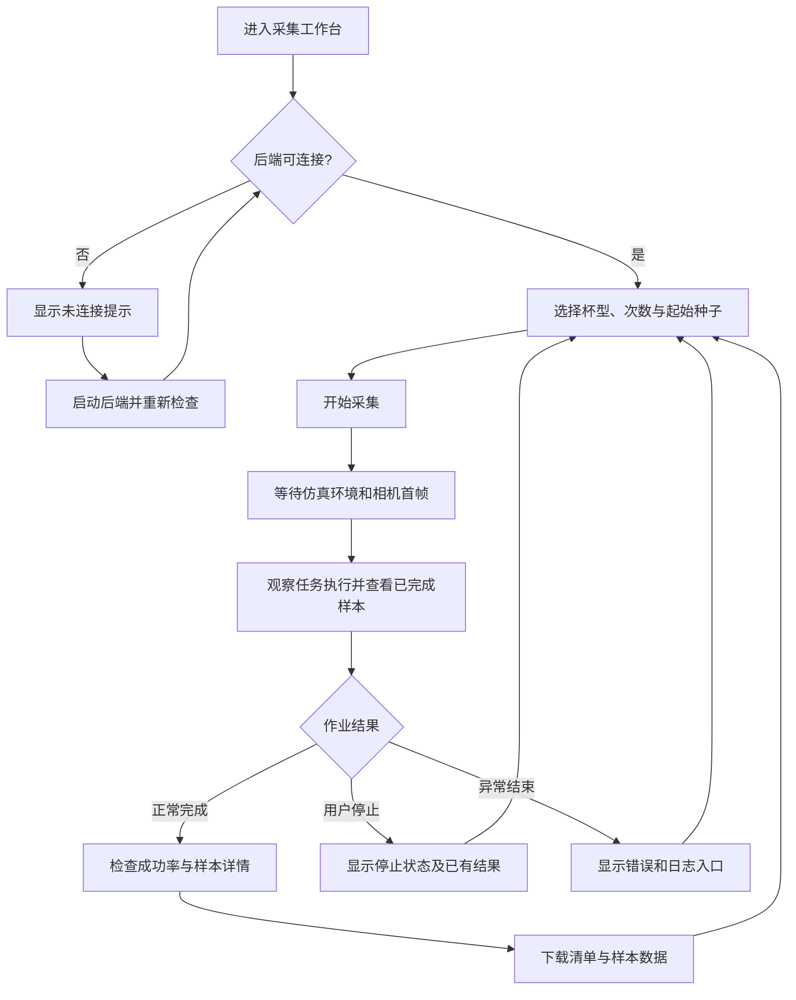

# RoboForge 前端需求与流程

版本：v0.1 讨论稿  
更新日期：2026-11-17  
适用范围：用于机器人仿真数据采集的网页版小 Demo。

本文记录已经确定的方向、当前 Demo 的功能和后续讨论顺序。“待完善”和“候选”内容尚未确定为本轮开发任务。启动方式见 [Demo 使用说明](../frontend/DEMO.md)。

> 后续实现更新：根据“可以直接提出场景、任务和采集数量要求”的新方向，现已新增正式 Studio Demo。本文下方保留 v0.1 的规划记录；最新使用流程、支持范围和接口见 [Studio 说明](../frontend/STUDIO.md)。Studio 已接入文字需求、本地任务解析、可编辑方案、三种桌面场景、方块/圆柱/杯子、抓放/方块推移、实时阶段提示、历史实验及样本回放。

## 1. 先确定目标

前端的主要目的是：帮助用户配置并执行一个机器人任务，观察执行过程，收集能够用于后续机器人学习的观测与动作数据。

首个任务固定为：**机械臂抓取桌面上的杯子，将其放入目标托盘，然后松开。**

第一版要把下面这条流程做清楚：

> 配置采集 → 执行任务 → 观察过程 → 检查结果 → 获取数据

内容上的吸引力来自用户能够看懂“机器人做了什么、记录了什么、任务是否完成”。画面、执行结果和导出的数据应能相互对应。

## 2. 已确定的范围

| 项目 | 第一版约定 |
| --- | --- |
| 使用对象 | 本地测试者、机器人数据采集与算法开发人员 |
| 运行方式 | 浏览器前端连接本机 RoboForge 后端 |
| 仿真环境 | 使用后端 MuJoCo 场景与物理计算 |
| 机器人与任务 | 默认项目的机械臂、杯子抓取与放置任务 |
| 操作物体 | 标准杯、高杯、宽口杯 |
| 控制方式 | 后端闭环专家自动执行，用户设置采集参数 |
| 采集内容 | 相机图像、关节状态、末端位姿、夹爪状态、动作、时间戳、物体位置、任务结果 |
| 数据输出 | 每条示范一个 NPZ 文件，整次采集一个 JSON 清单 |
| 页面组织 | 一个采集工作台，优先完成核心操作流程 |

第一版暂不纳入：账号权限、多人协作、实物机器人接入、多机器人调度、任意任务编辑、模型训练和部署。这些可以后续单独讨论。

## 3. 页面与功能需求

### 3.1 页面布局

桌面端将相机画面作为主要区域，旁边放采集设置，下方展示本次采集结果。移动端按“画面 → 设置 → 结果”排列。

| 区域 | 展示内容 | 用户操作 |
| --- | --- | --- |
| 连接状态 | 后端连接状态 | 检查连接 |
| 任务说明 | 任务名称、操作物体、执行目标 | 了解本次任务 |
| 相机画面 | 前视或腕部画面、仿真时间、Tick、当前采集序号 | 切换相机 |
| 采集设置 | 杯型、采集次数、起始随机种子 | 修改参数、开始采集、停止采集 |
| 结果概览 | 完成数量、样本帧数、成功率、采集进度 | 判断采集结果 |
| 样本列表 | 每条示范的种子、帧数、时长、任务结果 | 查看详情、下载 NPZ |
| 日志与导出 | 作业日志、数据清单 | 排查异常、下载 JSON 清单 |

### 3.2 当前功能基线

| 编号 | 功能 | 要求 | 当前状态 |
| --- | --- | --- | --- |
| F01 | 连接检查 | 显示后端是否可访问；未连接时禁用开始按钮 | 已实现 |
| F02 | 采集配置 | 选择杯型；次数为 1～20，默认 1；起始种子为 0～999999，默认 0 | 已实现 |
| F03 | 创建采集 | 提交任务后展示作业状态；运行期间锁定配置，避免重复提交 | 已实现 |
| F04 | 实时观察 | 展示本次采集的真实相机图像，支持前视、腕部切换 | 已实现 |
| F05 | 停止采集 | 用户可终止当前作业，并看到停止后的状态 | 已实现；部分数据的恢复与下载待完善 |
| F06 | 结果统计 | 每完成一条示范更新结果列表与汇总数据 | 已实现 |
| F07 | 样本详情 | 查看样本元信息，下载已完成数据集中的对应 NPZ | 已实现 |
| F08 | 清单导出 | 作业正常完成后下载 JSON 清单 | 已实现 |
| F09 | 刷新恢复 | 刷新页面后恢复最近一次作业的状态、结果和最后画面 | 已实现；不代表恢复全部表单设置 |
| F10 | 异常反馈 | 显示提交、读取、运行异常，并提供作业日志入口 | 基础已实现；断连提示与重试体验待完善 |

### 3.3 操作与数据规则

- 同一次采集包含多条示范，每条示范称为一个 Episode，即一次完整的任务尝试。
- 起始种子为 `S`、采集次数为 `N` 时，使用 `S` 至 `S + N - 1` 生成摆位。相同配置和种子用于复现实验。
- 当前进度按“已完成示范数 ÷ 计划示范数”计算，单条示范执行期间不显示虚构的完成百分比。
- 当前帧数汇总仅统计已经完成的示范；正在执行的示范通过 Tick 和仿真时间展示进展。
- 成功率按“任务成功的示范数 ÷ 已完成示范数”计算；尚无结果时显示“—”。
- 作业执行完成与机器人任务成功分别展示。即使采集作业正常结束，其中仍可能包含任务未成功的样本。
- 相机画面来自采集进程的观测缓存，导出数据保留实际采样时间。切换相机不改变任务执行。
- 默认控制和样本记录频率为 20 Hz，网页预览目标约 20 FPS。相机自身的采样频率与网页刷新频率分别对待。
- 当前使用可读取物体位置的专家控制器，应明确标注“专家示范”；这些结果不能直接代表训练后模型的能力。

## 4. 用户操作流程

### 4.1 进入页面

1. 检查默认项目是否可访问，显示连接结果。
2. 默认选择标准杯、采集 1 次、起始种子 0。
3. 如果存在最近一次作业记录，恢复其状态、样本结果和最后画面。
4. 首次使用时，展示任务说明和“开始采集”入口。

### 4.2 开始并观察采集

1. 用户确认参数，点击“开始采集”。
2. 前端提交采集作业，显示提交中或等待状态。
3. 后端构建环境，前端在首帧到达前显示准备提示。
4. 显示本次采集画面，允许切换前视与腕部相机。
5. 每完成一条示范，新增一行结果并更新统计。
6. 采集期间允许停止作业；设置保持锁定，结束后恢复可编辑。

### 4.3 检查并获取结果

1. 查看整次作业的状态和各条示范的任务结果。
2. 打开样本详情，检查种子、帧数与时长。
3. 作业正常完成并生成清单后，下载 JSON 清单和对应 NPZ。
4. 调整杯型或种子，再运行一组采集，比较结果。

当前“详情”只展示元信息和下载入口，尚不包含历史过程回放。停止或异常结束后可能留下部分 NPZ，但不保证生成完整清单，也不保证可从当前页面下载这些部分文件。

### 4.4 机器人执行过程

后端实际执行顺序为：

> 移到杯子上方 → 减速下降 → 逐渐合拢夹爪 → 确认双侧持续接触 → 抬升 → 搬运 → 减速放置 → 接触托盘 → 逐渐张开夹爪 → 撤离

机械臂移动采用加速度限制，夹爪按速度逐渐开合，杯子通过物理接触被抓取。当前模型仍使用简化的刚体与碰撞形状，夹爪姿态固定，尚未进行实物参数标定。

上述阶段目前是过程说明，页面尚未实时高亮具体阶段。机器人任务成功由后端判定，满足条件后可以结束记录，不要求完整记录最终撤离动作。

## 5. 状态与异常处理

| 状态或情况 | 用户应看到的反馈 | 可执行操作 |
| --- | --- | --- |
| 准备就绪 | 默认任务、参数与开始入口 | 修改参数、开始采集 |
| 等待执行 | 作业已提交，等待启动 | 等待或停止 |
| 构建环境、首帧未到 | 正在准备仿真与相机 | 等待或停止 |
| 采集中 | 画面、当前序号、时间、已有样本 | 切换相机、查看日志、停止 |
| 采集完成 | 完整结果；分别标明每条任务是否成功 | 查看详情、下载、再次采集 |
| 已停止 | 明确显示停止，已有完整样本继续可见 | 查看日志、重新采集 |
| 采集失败或已中断 | 显示错误、已有结果和日志入口 | 排查后新建采集 |
| 网络或后端暂时不可访问 | 保留已有画面，提示状态暂不可确认；不将其当作作业失败 | 恢复连接、重新查询；专用提示待完善 |
| 最近作业已不存在 | 清除失效恢复记录，回到可开始状态 | 重新配置与采集 |

刷新页面不会自动重建或重复提交采集。后端重启后的中断作业也不会自动续采；继续采集需要新建作业。

## 6. 第一版验收标准

1. 启动前后端后，用户无需编写代码即可完成一条标准杯示范的采集和下载。
2. 前视与腕部画面均来自实际采集环境；切换相机时任务连续执行。
3. 默认场景预览在当前本机环境接近 20 FPS；机器人逐渐加减速、夹紧和松开过程可辨认。
4. 单条样本中的观测与动作成对保存，时间戳有序，相机图像可解码。
5. 汇总统计与清单、NPZ 对应，不把“作业完成”统一标为“任务成功”。
6. 三种杯型均可配置和执行；使用多个种子验证，不只检查一个固定摆位。
7. 日志可查，停止与异常状态可区分；刷新不重复发起作业。
8. 正常结束后，清单和单条样本可以从页面下载。

其中，第 3 项是当前设备和默认配置的目标，具体帧数与运行时长随杯型、种子和配置变化。

## 7. 接下来按什么顺序讨论

每次先确定一个问题，再更新本文和实现范围。

| 顺序 | 要确定的问题 | 需要形成的结论 |
| --- | --- | --- |
| 1 | 这版 Demo 最希望用户看懂什么？ | 以“看懂采集过程”还是“检查采集数据”为下一步重点 |
| 2 | 什么样的一条示范算值得保留？ | 最少需要检查哪些画面、状态和结果；失败样本如何使用 |
| 3 | 先增强哪一个功能？ | 在样本回放、实时阶段提示、数据检查等候选中选一个 |
| 4 | 选中的功能放在哪里、怎么操作？ | 明确入口、界面内容、状态、返回路径 |
| 5 | 后端能否直接支持？ | 确定已有数据与接口，列出最少需要补充的能力 |
| 6 | 怎么判断这一轮完成？ | 写出可操作的验收步骤，再开始实现 |

候选功能尚未确定开发：

- **样本回放**：选一条已采集示范，回看两路相机画面，并按时间查看对应动作或状态。需要补充回放数据读取能力。
- **实时阶段提示**：显示当前正在接近、夹紧、抬升还是放置。需要后端提供实际阶段状态。
- **数据检查**：检查图像缺失、时间戳异常、样本是否完整；先定义检查规则。
- **采集对比**：比较不同杯型、摆位下的结果与时长；先明确用户要比较的问题。

建议先讨论“怎样检查刚刚采到的一条示范”，再决定是否优先做样本回放。

## 附录：当前接口对应关系

以下是现有 Demo 的接口记录，便于实现时核对。

| 用途 | 接口 |
| --- | --- |
| 连接与默认项目配置 | `GET /api/v1/config?project=default` |
| 创建采集作业 | `POST /api/v1/jobs`，提交 `kind: collect` 及采集参数 |
| 查询作业 | `GET /api/v1/jobs/{job_id}` |
| 读取相机预览 | `GET /api/v1/jobs/{job_id}/preview` |
| 读取日志 | `GET /api/v1/jobs/{job_id}/logs` |
| 停止作业 | `POST /api/v1/jobs/{job_id}/stop` |
| 读取数据清单 | `GET /api/v1/datasets/collection__{dataset_id}` |
| 下载单条 NPZ | `GET /api/v1/datasets/collection__{dataset_id}/episodes/{index}` |

当前采集请求包含默认项目、唯一数据集标识、杯型与种子列表，并使用 `realtime: true` 按仿真时间播放。样本索引从 0 开始，页面编号从 1 开始。数据写入 `datasets/collections/{dataset_id}/`。
